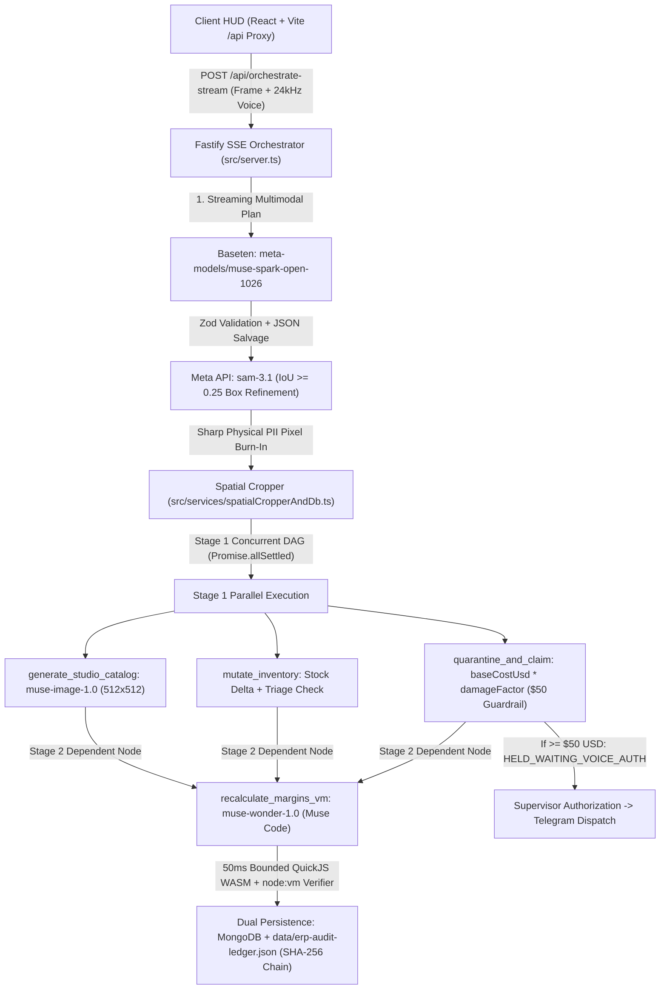

# Kinetix OS — Autonomous Spatial ERP & Warehouse Ledger Orchestrator powered by Meta AI

> **Meta Global AI Developer Hackathon Submission**
> **Author:** Gabriel Sebastián Resina Barrientos (`@Gabyresina15`)
> **Repository:** Unified Monorepo (`src/` Fastify SSE Orchestrator + `client/` React/Vite Spatial HUD)

Kinetix OS is an autonomous **Spatial ERP & Warehouse Ledger Orchestrator** built for industrial receiving docks. A single multimodal capture (live camera frame or workbench benchmark scene + operator voice directive) executes a closed-loop transactional DAG across four core Meta AI primitives:

1. **Muse Spark Open (`meta-models/muse-spark-open-1026` on Baseten)** performs real-time streaming multimodal reasoning, spatial object localization, physical PII region flagging, and strict Zod-validated DAG action synthesis (with automatic truncated-JSON stream salvage).
2. **SAM 3.1 (`sam-3.1` via Meta Vision API)** refines bounding-box geometry via **Intersection-over-Union (`computeIoU >= 0.25`)**, centroid containment, and area-ratio validation (`0.35x - 1.85x`), preventing full-bench merge artifacts and falling back cleanly to de-overlapped Spark boxes.
3. **Muse Code (`muse-wonder-1.0` via Meta API)** dynamically translates natural-language warehouse commercial rules and anomaly context into an executable `calculatePrice(ctx)` JavaScript policy, verified inside a **bounded 50ms isolated execution sandbox** (`quickjs-wasm` WebAssembly VM + `node:vm` verifier with deterministic fallback).
4. **Muse Image (`muse-image-1.0` via Meta API)** synthesizes `512x512` studio catalog assets from extracted Visual DNA for uncataloged hardware (`SKU-TRIAGE-PENDING`), with deterministic embedded SVG fallback.
5. **Muse Voice Transcribe (`muse-voice-transcribe-1.0` via Meta Audio API)** transcribes `24kHz` 16-bit mono PCM `RIFF/WAVE` operator voice directives (paired with browser Web Speech API fallback).

---

## 1. Judge Quickstart (1-Command Verification)

This repository is a unified monorepo containing both the Fastify backend (`src/`, port `4000`) and the React + Vite frontend (`client/`, port `5173` proxying `/api` to `http://localhost:4000`).

```bash
# 1. Clone and install dependencies (root + client workspace)
git clone https://github.com/Gabyresina15/kinetix-os.git
cd kinetix-os
npm install
npm --prefix client install

# Option A: Instant Replay Mode (Zero API keys or MongoDB required — uses recorded golden traces)
npm run replay

# Option B: Live API Mode (Connects to Baseten Muse Spark Open + Meta AI APIs)
cp .env.example .env
npm run dev

# Restore the canonical 31-SKU ERP inventory & reset data/erp-audit-ledger.json to genesis
npm run reset

# Run the automated end-to-end verification test suite
npm test
```

Once running, open **`http://localhost:5173`** in Chrome or Edge:
- Click **`CAPTURE & ORCHESTRATE (ENTER)`** to trigger the full multimodal SSE stream (`VISION_SCAN_STARTED` -> `SPATIAL_LOCK` -> `SPARK_REASONING_TOKEN` -> `SPARK_PLAN_LOCKED` -> Stage 1 & Stage 2 `TOOL_MUTATED` -> `ORCHESTRATION_COMPLETE`).
- Observe the **$50 USD Financial Guardrail** intercept the `$66.30 USD` supplier claim (`SKU-AIR-SINGLE-TOWER`, base cost `$78.00 * 0.85` `CRITICAL` fin deformation factor) in `HELD_WAITING_VOICE_AUTH` state, and click **`AUTHORIZE ($66.30)`** to release the claim to the ledger and Telegram.
- Inspect the **SHA-256 Cryptographic Audit Ledger** (`AUDIT LEDGER` button in header) and click **`UNDO TX`** on any stock or pricing mutation to execute an atomic compensating rollback.

---

## 2. Environment Variables

Copy `.env.example` to `.env` for `LIVE` mode. In `REPLAY` mode (`npm run replay`), no external credentials or database processes are required.

| Variable | Required in `LIVE` | Default / Model Target | Purpose |
| :--- | :---: | :--- | :--- |
| `BASETEN_API_KEY` | Yes | — | Authenticates streaming requests to Baseten Open-Weight endpoint |
| `BASETEN_MODEL` | No | `meta-models/muse-spark-open-1026` | Open-Weight multimodal planner model slug on Baseten |
| `META_MODEL_API_KEY` | Yes | — | Authenticates requests to Meta AI (`sam-3.1`, `muse-wonder-1.0`, `muse-image-1.0`, `muse-voice-transcribe-1.0`) |
| `META_API_BASE_URL` | No | `https://api.meta.ai/v1` | Unified base URL for Meta AI vision, code, image, and voice endpoints |
| `META_IMAGE_SIZE` | No | `512x512` | Output resolution for `muse-image-1.0` studio catalog asset synthesis |
| `MONGODB_URI` / `MONGO_URI` | Optional | Local JSON fallback (`data/erp-audit-ledger.json`) | Dual persistence: writes to MongoDB when reachable and mirrors every state transition to `data/erp-audit-ledger.json` |
| `TELEGRAM_BOT_TOKEN` & `TELEGRAM_CHAT_ID` | Optional | Offline ledger receipt | Dispatches real-time warehouse claim notifications with inline photo crops via Telegram Bot API |

---

## 3. System Architecture & Meta AI Model Integration



### Meta AI Models & Source Code Mapping

| Meta AI Model / Tool | Model Identifier | Primary Source File & Function | Role in the Closed-Loop ERP Pipeline |
| :--- | :--- | :--- | :--- |
| **Muse Spark Open** *(Open-Weight on Baseten)* | `meta-models/muse-spark-open-1026` | `src/services/modelProviders.ts` -> `callBasetenMuseSparkOpen()` | Streams reasoning tokens (tracking real `firstTokenLatencyMs` and total network `latencyMs`), localizes workbench objects, flags physical PII shipping labels, and outputs the structured JSON execution plan. |
| **SAM 3.1** | `sam-3.1` | `src/services/modelProviders.ts` -> `callSam31Segmentation()` & `computeIoU()` | Refines Spark bounding boxes via Intersection-over-Union (`IoU >= 0.25`), centroid containment, and area-ratio bounds (`0.35x - 1.85x`), falling back to de-overlapped Spark boxes on mismatch. |
| **Muse Code** | `muse-wonder-1.0` | `src/services/modelProviders.ts` -> `callMuseCodeGenerator()` | Receives natural-language warehouse commercial rules (target margin, high-inventory discount tier, damage handling surcharge, tax rate) and synthesizes `calculatePrice(ctx)` dynamically without a pre-baked formula. |
| **Muse Image** | `muse-image-1.0` | `src/services/modelProviders.ts` -> `callMuseImageStudioSynthesis()` | Synthesizes `512x512` studio product thumbnails from extracted Visual DNA (`containerGeometry`, `exactColorPalette`, `surfaceMaterial`) for uncataloged items (`SKU-TRIAGE-PENDING`), with deterministic SVG fallback. |
| **Muse Voice Transcribe** | `muse-voice-transcribe-1.0` | `src/services/voiceTranscribeService.ts` -> `transcribeWarehouseAudio()` | Validates 44-byte `RIFF/WAVE` headers (`24kHz` 16-bit mono PCM) captured by the WebAudio recorder and transcribes hands-free dock commands. |

---

## 4. Technical Verification & Engineering Depth

- **Stage-Based Concurrent DAG Execution (`src/server.ts`):** Actions emitted by `muse-spark-open-1026` are grouped into dependency stages (`ACTION_DEPENDENCY_STAGE`). Stage 1 (`quarantine_and_claim`, `mutate_inventory`, `generate_studio_catalog`) executes concurrently via `Promise.allSettled` with individual per-node timeouts (`withNodeTimeout`). Stage 2 (`recalculate_margins_vm`) executes after Stage 1 settles so batch repricing operates on the updated post-intake inventory stock levels.
- **Evidence-Based `$50 USD` Financial Guardrail (`src/contracts/orchestratorCore.ts`):** Claim valuation never uses static fallback numbers. `computeEvidenceBasedClaimUsd()` computes `claimAmountUsd = Number((baseCostUsd * damageFactor).toFixed(2))` from the matched catalog SKU's `baseCostUsd` and the visual `defectSeverity` (`INTACT` = `0.0`, `MINOR` = `0.25`, `MODERATE` = `0.65`, `CRITICAL` = `0.85`). An intact item yields `$0.00 USD`, a minor cosmetic scuff on `SKU-AIR-SINGLE-TOWER` (`$78.00 * 0.25 = $19.50`) auto-dispatches below `$50 USD`, and a critical bent heatsink fin (`$78.00 * 0.85 = $66.30`) triggers `HELD_WAITING_VOICE_AUTH` until supervisor confirmation.
- **Bounded 50ms Policy Sandbox (`src/services/wasmPricingSandbox.ts`):** Synthesized `calculatePrice(ctx)` code is verified against unit assertions (finite output, cost-floor protection, anti-gouging cap, and cost monotonicity) inside an isolated QuickJS WebAssembly runtime (`quickjs-emscripten`, 4MB memory cap, 50ms interrupt handler) paired with a bounded 50ms `node:vm` verifier (`executeBoundedNodeVmPolicy`) and deterministic arithmetic fallback.
- **Physical Sharp PII Redaction (`src/services/spatialCropperAndDb.ts`):** Before any product crop is extracted or persisted, `extractRealCropsFromFrame()` composites opaque SVG redaction shields (`REDACTED PII // WAYBILL SHIELD`) over any region flagged with `isSensitivePII: true`.
- **SHA-256 Cryptographic Audit Ledger & Dual Persistence (`src/services/auditLedger.ts`):** Every state mutation records a `beforeSnapshot` and `afterSnapshot` linked by a verifiable SHA-256 hash chain, persisted both to MongoDB (when configured) and to `data/erp-audit-ledger.json`, supporting single-click atomic compensating rollbacks (`POST /api/audit-ledger/undo`).

---

## 5. Hackathon Submission Summary

- **Impact:** Eliminates manual barcode scanning, spreadsheet price recalculation, and unverified supplier damage claims on warehouse receiving docks by turning a single camera frame and voice command into audited ERP mutations guarded by an evidence-based `$50 USD` financial circuit breaker.
- **Use of Meta AI Tooling:** Combines `meta-models/muse-spark-open-1026` on Baseten for streaming spatial DAG planning, `sam-3.1` for IoU-validated bounding-box refinement, `muse-wonder-1.0` (Muse Code) for dynamic commercial pricing synthesis, `muse-image-1.0` for `512x512` studio asset generation, and `muse-voice-transcribe-1.0` for 24kHz PCM voice capture.
- **Eligible Bonus Categories:**
  - **Best Build on Meta Open Weight Models:** Powered by `meta-models/muse-spark-open-1026` deployed on Baseten (`src/services/modelProviders.ts`).
  - **Best Agentic Use-Case:** Multi-stage autonomous DAG orchestrator executing real database mutations, sandboxed code synthesis, cryptographic audit logging, and conditional human-in-the-loop financial holds.
