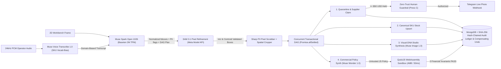

# KINETIX OS — Closed-Loop Spatial ERP Orchestrator

**Meta Global AI Developer Hackathon** | **Track:** Indie Developer | **Pillar:** *Push the Frontier*  
**Frontend Repository:** [Gabyresina15/kinetix-ui](https://github.com/Gabyresina15/kinetix-ui)

KINETIX OS turns a raw workbench camera frame and a single spoken operator directive into an audited, multi-tool transactional DAG over physical inventory. Rather than acting as a passive image captioner or static RAG chatbot, KINETIX OS coordinates **five live Meta AI runtime models** across voice, multimodal spatial planning, pixel segmentation, studio asset synthesis, and WebAssembly-isolated pricing code — governed by physical Sharp PII pixel scrubbing, a **$50 USD Zero-Trust financial guardrail**, and a **cryptographic SHA-256 hash-chained ERP Audit Ledger** with 1-click compensating rollback.

---

## 1. Closed-Loop Spatial Control Architecture



---

## 2. Full 5-Model Meta AI Runtime Matrix (+ Muse Code)

| Model / Tool | Provider & Endpoint | Exact Role in KINETIX OS | Implementation |
| :--- | :--- | :--- | :--- |
| **`muse-voice-transcribe-1.0`** | **Meta Model API** (`POST /v1/asr/transcribe`) | Transcribes 24 kHz mono 16-bit PCM operator directives (`PUSH_TO_TALK`) with Spanish/English code-switching (`languageBias`) and **dynamic ERP SKU vocabulary biasing** (`keywords` injected live from `inventory_catalog`). | `src/services/modelProviders.ts` (`callMuseVoiceTranscribe`), `POST /api/voice/transcribe` |
| **`meta-models/muse-spark-open-1026`** | **Baseten** (`POST /v1/chat/completions`, 2M TPM) | Open-weight multimodal spatial scene understanding, PII detection (`isSensitivePII`), Visual-DNA extraction, and multi-tool JSON DAG planning with live SSE reasoning deltas (`SPARK_REASONING_DELTA`). | `src/services/modelProviders.ts`, `src/prompts/sparkSystemPrompt.ts` |
| **`sam-3.1`** | **Meta Model API** (`POST /v1/responses`) | Pixel-accurate bounding-box refinement using adaptive search padding (8%–16%) validated against IoU (`>= 0.05`), centroid containment, and area-ratio (`0.1x–3.0x`) guardrails. | `src/services/modelProviders.ts` (`refineMasksWithSam31`) |
| **`muse-image-1.0`** | **Meta Model API** (`POST /v1/images/generations`) | Crop-to-Studio catalog synthesis (`1024x1024` with automatic `512x512` fallback) driven by structured Visual DNA (`containerGeometry`, `exactColorPalette`, `detectedBrandOrText`, `surfaceMaterial`). | `src/services/modelProviders.ts`, `src/contracts/orchestratorCore.ts` |
| **`muse-wonder-1.0`** | **Meta Model API** (`POST /v1/chat/completions`) | Translates natural-language commercial rules (margins, VAT, overstock volume discounts, scarcity buffers) into executable JavaScript functions evaluated inside **QuickJS WebAssembly**. | `src/services/modelProviders.ts`, `src/services/wasmPricingSandbox.ts` |
| **`Muse Code`** | Meta Coding Agent | Accelerated TypeScript SSE contract, Zod salvage parser, and QuickJS WASM harness development. | Codebase tooling |

---

## 3. Production Systems Engineering Guarantees

1. **QuickJS WebAssembly Policy Sandbox (`src/services/wasmPricingSandbox.ts`):**
   - Replaces Node's non-isolated `node:vm` with `quickjs-emscripten` running inside isolated WASM linear memory (`4 MB` memory ceiling, `256 KB` stack cap, `50 ms` hard CPU interrupt deadline).
   - Zero access to Node `process`, `require`, filesystem, or network (`typeof process === 'undefined'` even across prototype-chain probes).
   - **Pre-Commit Financial Invariants:** Every synthesized pricing policy must pass three deterministic checks inside WASM before mutating SKU prices:
     1. *No-Loss Floor:* `price > unitCost`
     2. *Anti-Gouging Ceiling:* `price <= unitCost * 4.5`
     3. *Cost Monotonicity:* `calculatePrice(cost * 1.2) > calculatePrice(cost)`
2. **Cryptographic SHA-256 Audit Ledger & Atomic Compensating Rollback (`src/services/auditLedger.ts`):**
   - Every ERP state transition (`STOCK_DELTA`, `WASM_REPRICE`, `SUPPLIER_CLAIM`, `GUARDRAIL_AUTHORIZED`, `STUDIO_SYNTH`, `SUPERVISOR_TRIAGE`) appends an immutable SHA-256 hash-chained block (`prevHash -> txHash`) verified continuously via `verifyAuditChainIntegrity()`.
   - Operators can trigger 1-click compensating rollbacks (`POST /api/audit-ledger/undo`) to atomically restore pre-mutation stock, revert WASM price changes, or revoke accidental supplier claims while appending a permanent `COMPENSATING_UNDO` audit block.
3. **Physical Sharp PII Pixel Scrubbing (`src/services/spatialCropperAndDb.ts`):**
   - Whenever **Muse Spark Open** flags shipping waybills, customer invoices, ID badges, personal screens, or faces (`isSensitivePII: true`), `Sharp` composites opaque `PII REDACTED` shields directly onto a sanitized copy of the frame buffer **before** extracting any product crop — guaranteeing PII pixels never reach MongoDB or external Telegram webhooks.
4. **Zero-Trust `$50` Financial Guardrail (`POST /api/confirm-guardrail`):**
   - Any physical defect claim `>= $50.00 USD` freezes in `HELD_WAITING_VOICE_AUTH` and withholds external webhook dispatch until an operator explicitly authorizes it (`[PRESS C]`), at which point the cropped defect evidence is dispatched via Telegram Bot API (`sendPhoto`) and recorded in MongoDB.

---

## 4. Judge Quickstart (Zero API Keys & Zero MongoDB Required)

You can run the full deterministic pipeline and automated test suite locally in under 60 seconds using the recorded Baseten `muse-spark-open-1026` golden fixture (`fixtures/golden-path/golden-spark-replay.json`):

```bash
git clone https://github.com/Gabyresina15/kinetix-os.git
cd kinetix-os
npm install

# 1. Run automated unit & integration tests (WASM RCE isolation, 50ms loop interrupt, invariants, PII pixel scrubbing, Muse Voice WAV check, SHA-256 Ledger & Undo, TCP SSE replay)
npm test

# 2. Start orchestrator in deterministic REPLAY mode on http://localhost:4000
npm run replay
```

### Running in `LIVE` Mode (Baseten + Meta Model API)

1. Copy `.env.example` to `.env` and populate `BASETEN_API_KEY` and `META_MODEL_API_KEY` (plus optional `MONGO_URI`, `TELEGRAM_BOT_TOKEN`, and `TELEGRAM_CHAT_ID`).
2. *(Optional)* Seed MongoDB with the 31 canonical hardware SKUs:
   ```bash
   npm run seed
   ```
3. Start the live orchestrator:
   ```bash
   npm run dev
   ```

### One-Command Docker Compose

```bash
docker compose up --build
```

---

## 5. HTTP & SSE API Surface

- `POST /api/voice/transcribe` — Multipart proxy to **Muse Voice Transcribe (`muse-voice-transcribe-1.0`)** with dynamic ERP catalog SKU vocabulary biasing (`24 kHz` mono 16-bit PCM RIFF/WAVE).
- `POST /api/orchestrate-stream` — Multimodal SSE stream (`VISION_SCAN_STARTED` → `EDGE_PII_SHIELD` → `SPATIAL_LOCK` → `SPARK_REASONING_DELTA` → `SPARK_REASONING_TRACE` → `SPARK_PLAN_LOCKED` → `TOOL_MUTATED` / `TOOL_FAILED` → `ORCHESTRATION_COMPLETE`).
- `POST /api/confirm-guardrail` — Human-in-the-loop authorization & Telegram photo dispatch for held `>= $50` supplier claims.
- `POST /api/triage/resolve` — Supervisor human-in-the-loop resolution for unverified/triage SKUs (`STOCK` or `CLAIM`).
- `GET /api/audit-ledger` — Returns SHA-256 hash-chain integrity verification and full transaction block stream.
- `POST /api/audit-ledger/undo` — Executes atomic compensating rollback (`RESTORE_STOCK`, `RESTORE_PRICE`, `REVOKE_CLAIM`) and appends a `COMPENSATING_UNDO` block.
- `POST /api/reset-demo` — Restores the clean 31-SKU canonical catalog state and resets the session audit chain.
- `GET /api/live-ledger` — Returns current canonical inventory snapshot.
- `GET /api/health` — Reports orchestrator mode, MongoDB connectivity, provider readiness, SHA-256 ledger validity, and live QuickJS WASM isolation probe.

---

## 6. Hackathon Timeline & Disclosure

- **Hackathon Window:** Built specifically for the Meta Global AI Developer Hackathon (October 27 – November 4, 2026).
- **Timestamp Note:** Initial empty/scaffold commits (`Initial commit` boilerplate) were created on the evening of October 26 (~21:00 ART / UTC-3) while setting up the local TypeScript workspace; 100% of the spatial orchestration engine, Meta Model API (`muse-voice-transcribe-1.0`, `sam-3.1`, `muse-image-1.0`, `muse-wonder-1.0`) and Baseten (`meta-models/muse-spark-open-1026`) integrations, QuickJS WASM sandbox, SHA-256 audit ledger, MongoDB persistence, and tactical UI were developed during the hackathon period.
- **License:** [MIT](./LICENSE)
